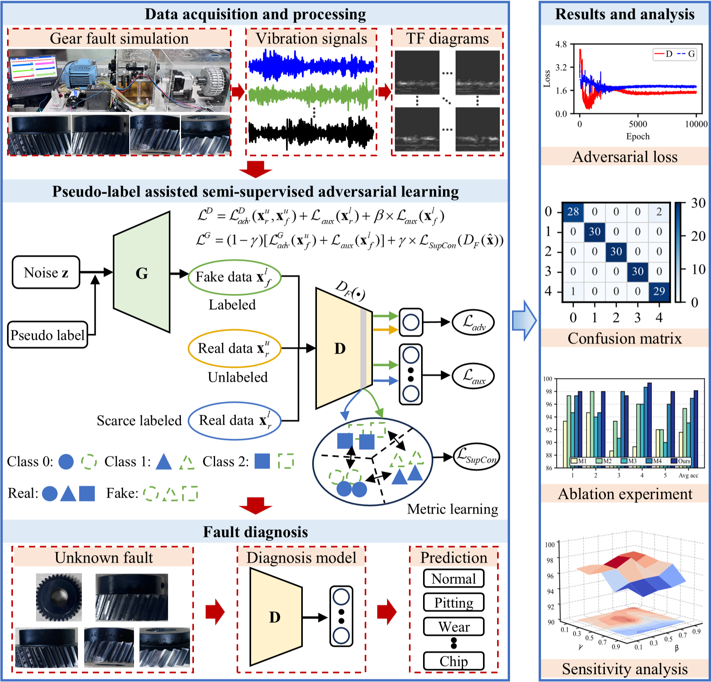

# Pseudo-label-SSAEL

This is the impletement of ***[Pseudo-label assisted semi-supervised adversarial enhancement learning for intelligent fault diagnosis of industrial gearbox degradation](https://doi.org/10.1016/j.ymssp.2024.112108)*** .

## Abstract

The gearbox plays a crucial role in the transmission system of mechanical equipment, yet its failure is frequent due to complex operational environments. Existing data-driven methods utilizing deep learning (DL) have yielded satisfactory results in intelligent fault diagnosis (IFD). However, most IFD methods rely on supervised learning, which requires a large number of labeled samples to train the DL model, posing a significant challenge in practical applications due to the difficulty of collecting sufficient annotated data. To address this issue, a pseudo-label assisted semi-supervised adversarial enhancement learning method is proposed for gearbox degradation IFD in this paper. Firstly, a semi-supervised adversarial learning framework with pseudo-label assistance is constructed, enabling full utilization of massive unlabeled data to capture representations of potential features. Subsequently, the generated labeled data, real unlabeled data as well as limited labeled data, are used simultaneously to train the adversarial model, thereby greatly reducing the requirement for data annotation. Additionally, an enhanced optimization strategy based on metric learning is integrated into the developed semi-supervised framework to align the distribution of generated and real data and then improve feature discriminability across categories. Finally, fault diagnosis experiments conducted on two self-built gearbox test rigs demonstrate that the proposed method achieves higher diagnosis accuracy and lower dependency on annotated samples than the compared ones. Comprehensive ablation studies further reveal the effectiveness and superiority of the presented approach.

## Graphical Abstract



## Highlights

* Propose a semi-supervised adversarial learning method for gearbox fault diagnosis under scenarios of scarce labeled data.
* Utilize both labeled and unlabeled data, reducing the need for extensive data annotation.
* Integrate supervised contrastive learning to enhance feature discriminability across categories.
* Validate on the gearbox test rig, demonstrating superior identification accuracy and lower annotation dependency.

## Uasge

### Project Structure

The project is organized as follows:

```
.
|-- README.md
|-- datasets
|   `-- Gear
|-- graphical_abstract.png
|-- models
|   `-- sgan.py
|-- scripts
|   `-- train.sh
|-- train_sgan.py
`-- utils
    |-- losses.py
    |-- read_cwt_figures.py
    |-- supcontrast_loss.py
    `-- utils.py
```

* `README.md`: Provides instructions for setting up and running the code.

* `datasets`: Contains the dataset used in this study.

* `graphical_abstract.png`: Provides the graphical abstract of the proposed method.
* `models`: Contains the implementation of the SGAN model.
* `scripts`: Contains shell scripts for launching training experiments.
* `train_sgan.py`: The main entry point for model training.
* `utils`: Contains utility functions and loss implementations used in the project.

### Requirements

* Python: 3.8.16
* PyTorch: 2.0.0+cu118
* Torchvision: 0.15.0+cu118
* CUDA: 11.8
* CUDNN: 8700
* NumPy: 1.23.4
* PIL: 10.0.1

### Data preparation

Place the image dataset under `datasets/Gear/real_images/`, or specify another dataset root using `--real_folder`. The dataset root is expected to contain `train`, `valid`, and `test` subdirectories:

```
./datasets/Gear/real_images/
├── test
│   ├── 0-0.jpg
│   ├── 1-0.jpg
...
│   ├── 100-1.jpg
...
├── train
│   ├── 0-0.jpg
│   ├── 1-0.jpg
...
│   ├── 200-1.jpg
...
└── valid
    ├── 0-0.jpg
    ├── 1-0.jpg
    ...
```

### Training

To run `train_sgan.py`

```bash
$ python train_sgan.py
```

Alternatively, run the provided shell script from the repository root:

```bash
$ bash scripts/train.sh
```

## Acknowledgements

1. [[2109.02235\] Gradient Normalization for Generative Adversarial Networks](https://arxiv.org/abs/2109.02235) 
1. [[1606.01583\] Semi-Supervised Learning with Generative Adversarial Networks](https://arxiv.org/abs/1606.01583)
1. [[1606.03498\] Improved Techniques for Training GANs](https://arxiv.org/abs/1606.03498)
1. [[2004.11362\] Supervised Contrastive Learning](https://arxiv.org/abs/2004.11362)
1. [[2002.05709\] A Simple Framework for Contrastive Learning of Visual Representations](https://arxiv.org/abs/2002.05709)
1. [Conditional Contrastive Domain Generalization for Fault Diagnosis | IEEE Journals & Magazine | IEEE Xplore](https://ieeexplore.ieee.org/document/9721021)

## Citation

If you find our work is relevant to your research, please cite:

```
@article{chen2025pseudo,
  title={Pseudo-label assisted semi-supervised adversarial enhancement learning for fault diagnosis of gearbox degradation with limited data},
  author={Chen, Xin and Chen, Zaigang and Guo, Liang and Zhai, Wanming},
  journal={Mechanical Systems and Signal Processing},
  volume={224},
  pages={112108},
  year={2025},
  doi={10.1016/j.ymssp.2024.112108}
  }
```

X. Chen, Z. Chen, L. Guo, W. Zhai, Pseudo-label assisted semi-supervised adversarial enhancement learning for fault diagnosis of gearbox degradation with limited data, Mechanical Systems and Signal Processing, 224 (2025) 112108.

## Contact

If you have any questions, please do not hesitate to contact us：

* Xin Chen
* chenxinnpu@gmail.com
* chenxin2022 [at] my.swjtu.edu.cn

